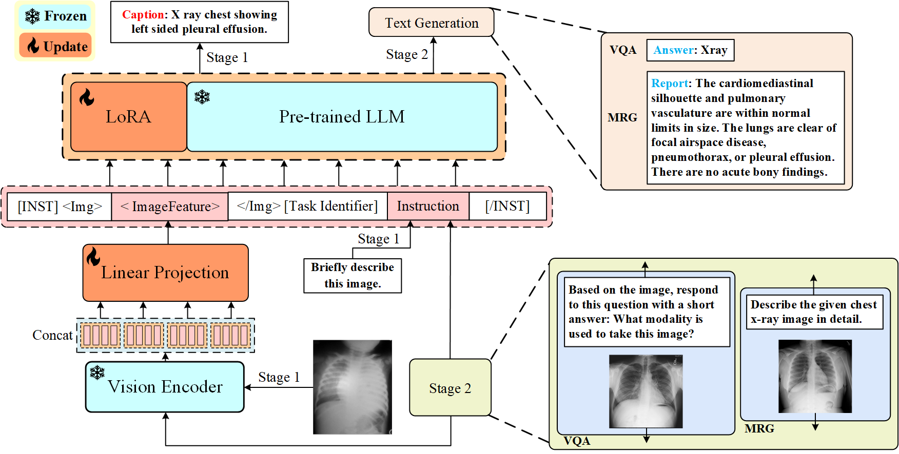

# PeFoMed
This is the official implementation of [PeFoMed: Parameter Efficient Fine-tuning of Multimodal Large Language Models for Medical Imaging](https://arxiv.org/abs/2401.02797).

<div align=center>

</div>
<center>Figure 1: Overview of the PeFoMed. </center>

## Datasets
The configuration of all datasets needs to be set in the corresponding dataset configuration file in the **pefomed/configs/datasets/medical**

Stage 1 finetune datasets: [ROCO](https://link.springer.com/chapter/10.1007/978-3-030-01364-6_20), [CLEF2022](https://ceur-ws.org/Vol-3180/paper-95.pdf), [MEDICAT](https://arxiv.org/abs/2010.06000), and [MIMIC-CXR](https://arxiv.org/abs/1901.07042)

Stage 2 finetune medical VQA datasets: [VQA-RAD](https://www.nature.com/articles/sdata2018251#data-citations), [PathVQA](https://arxiv.org/abs/2003.10286) and [Slake](https://arxiv.org/abs/2102.09542).

Stage 2 finetune MRG dataset: [IU-Xray](https://pubmed.ncbi.nlm.nih.gov/26133894/)

## Checkpoints
You can download the checkpoints in [HuggingFace](https://huggingface.co/SmallBosser/PeFoMed)

## Parameter Efficient Fine-tuning (PEFT) Methods

**Updated: December 14, 2025** - Added support for Prompt Tuning and Prefix Tuning methods in addition to the existing LoRA method.

PeFoMed supports three PEFT methods for efficient model adaptation:

### LoRA (Low-Rank Adaptation)
LoRA is the default PEFT method that adds trainable low-rank matrices to the model's attention layers. It provides a good balance between parameter efficiency and performance.

**Configuration:**
- `peft_method: "lora"`
- `lora_r`: Rank of the low-rank matrices (default: 64)
- `lora_alpha`: Scaling factor (default: 16)
- `lora_target_modules`: Target modules to apply LoRA (default: ["q_proj", "v_proj"])

### Prompt Tuning
Prompt Tuning adds trainable virtual tokens (soft prompts) at the beginning of the input sequence. This method is memory-efficient and works well with simplified instruction formats.

**Configuration:**
- `peft_method: "prompt_tuning"`
- `prompt_tuning_num_virtual_tokens`: Number of virtual tokens (default: 20)
- `prompt_tuning_init_text`: Optional initialization text for the prompts (e.g., "Answer the medical question:")
- **Recommended:** Set `use_instruction_pool: false` in dataset configuration to allow soft prompts to handle instruction roles

**Example configuration:**
```yaml
model:
  peft_method: "prompt_tuning"
  prompt_tuning_num_virtual_tokens: 20
  prompt_tuning_init_text: "Answer the medical question:"

datasets:
  vqarad:
    dataset_kwargs:
      use_instruction_pool: false  # Recommended for Prompt Tuning
```

### Prefix Tuning
Prefix Tuning prepends trainable prefix embeddings to the input, which can be optionally projected through an encoder network. This method is flexible and can work with full instruction formats.

**Configuration:**
- `peft_method: "prefix_tuning"`
- `prefix_tuning_num_virtual_tokens`: Number of prefix tokens (default: 20)
- `prefix_tuning_encoder_hidden_size`: Optional encoder hidden size for prefix projection (e.g., 512). If not set, uses the model's hidden size without projection.
- **Recommended:** Set `use_instruction_pool: true` in dataset configuration to leverage full instruction formats

**Example configuration:**
```yaml
model:
  peft_method: "prefix_tuning"
  prefix_tuning_num_virtual_tokens: 20
  prefix_tuning_encoder_hidden_size: 512  # Optional: enables projection layer

datasets:
  vqarad:
    dataset_kwargs:
      use_instruction_pool: true  # Recommended for Prefix Tuning
```

### Usage
You can switch between PEFT methods by setting the `peft_method` parameter in your training configuration file. Example training scripts are available in `run_scripts/minigpt4/`:
- `train_prompt_experiments.sh` - Prompt Tuning experiments
- `train_prefix_experiments.sh` - Prefix Tuning experiments

## Acknowledgement
If you're using PeFoMed in your research or applications, please cite using this BibTeX:
```bibtex
@misc{liu2024pefomedparameterefficientfinetuning,
      title={PeFoMed: Parameter Efficient Fine-tuning of Multimodal Large Language Models for Medical Imaging}, 
      author={Jinlong He and Gang Liu and Pengfei Li and Genrong He and Zhaolin Chen and Shenjun Zhong},
      year={2024},
      eprint={2401.02797},
      archivePrefix={arXiv},
      primaryClass={cs.CL},
      url={https://arxiv.org/abs/2401.02797}, 
}
```
## License
This repository is under [BSD 3-Clause License](LICENSE.md).

Many codes are based on [Lavis](https://github.com/salesforce/LAVIS) and [MiniGPT-v2](https://github.com/Vision-CAIR/MiniGPT-4)

